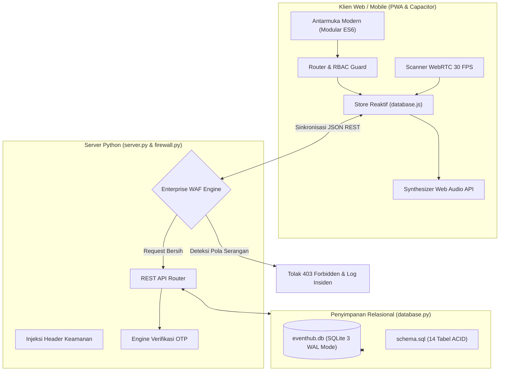

<p align="center">
  
</p>

<h1 align="center">EventHub Pro</h1>

<p align="center">
  Platform sistem manajemen tiket acara, POS kasir gate scanner, dan dashboard enterprise modern terintegrasi — dengan arsitektur role-based access (RBAC), scanner WebRTC kamera real-time, zero-knowledge privacy, dan Web Application Firewall (WAF) berlapis.
</p>

<p align="center">
  
  <a href=".github/workflows/ci.yml"></a>
  
  
  
  
</p>

<p align="center">
  <a href="docs/MANUAL.md">Panduan Pengguna</a> ·
  <a href="docs/ARCHITECTURE.md">Arsitektur Sistem</a> ·
  <a href="demo-project/README.md">Paket Demo</a> ·
  <a href="#cara-menjalankan">Instalasi</a> ·
  <a href="#kredensial-akun-demo">Akun Demo</a>
</p>

---

## Tentang EventHub Pro

**EventHub Pro** adalah platform *all-in-one* pengelolaan tiket acara dan operasional *gate access* berskala industri yang dirancang dengan performa tanpa kompromi. Mengusung arsitektur *zero-dependency frontend* dan backend relasional SQLite 3 mode WAL, sistem ini menjamin kecepatan rendering instan, reliabilitas transaksi ACID, serta proteksi keamanan aktif terhadap serangan siber umum seperti SQL Injection dan XSS melalui modul Enterprise WAF bawaan.

Aplikasi ini mencakup seluruh siklus hidup acara: mulai dari publikasi konser dan turnamen oleh promotor, pembelian tiket multi-tier dengan kupon promo diskon, penerbitan e-tiket SVG QR code, validasi tiket berkecepatan tinggi di pintu gerbang menggunakan kamera WebRTC, manajemen pengajuan refund dana, hingga pelaporan keuangan kasir Moneyflow real-time.

---

## Fitur Utama

- **POS Kasir Gate & WebRTC Camera Scanner.** Pemindaian kode QR tiket berkecepatan 30 FPS langsung melalui webcam laptop atau kamera ponsel tanpa aplikasi scanner tambahan. Dilengkapi validasi instan (VALID, ALREADY_USED, REFUNDED) dan input kode manual.
- **Audio Prosedural & Animasi Confetti Canvas.** Sintesis efek suara cerdas menggunakan Web Audio API tanpa perlu mengunduh file MP3/WAV eksternal (chime frekuensi ganda untuk sukses, sawtooth buzz untuk penolakan) serta simulasi fisika partikel confetti canvas 2D.
- **Enterprise Web Application Firewall (WAF).** Modul firewall mandiri di level server yang secara proaktif menyaring dan memblokir serangan SQL Injection (SQLi), Cross-Site Scripting (XSS), Path Traversal, Bot Scanners, serta brute-force login.
- **Kebijakan Zero-Knowledge Privacy Administrator.** Akun root `superadmin` tidak pernah ditampilkan pada tabel pengguna umum (`Store.getUsers()`) dan seluruh aktivitas audit admin disamarkan menjadi `Administrator Sistem (Privat)` (`admin@private.internal`).
- **Paket Membership Fast-Track VIP.** Fitur jalur gate prioritas tanpa antre bagi peserta berlangganan (Silver Express, Gold VIP Pass, dan Platinum Black Access) dengan badge dinamis pada header navbar dan e-tiket.
- **CMS Hero Banner & Galeri Multimedia.** Pengaturan visual banner interaktif dengan background video bergerak MP4, pemutar video trailer teaser acara, serta galeri foto beresolusi tinggi yang dapat diedit langsung oleh Super Admin.
- **Dukungan Multi-Platform (PWA & Mobile Native).** Siap dijalankan sebagai aplikasi web responsif, Progressive Web App (PWA) offline dengan Service Worker, maupun dibundel menjadi aplikasi Android & iOS via Capacitor 6.

---

## Matriks Hak Akses & Peran Pengguna (RBAC)

| Kemampuan / Fitur | Super Administrator | Penyelenggara (Organizer) | Peserta VIP Gold | Peserta Reguler |
|---|:---:|:---:|:---:|:---:|
| **Jelajah & Beli Tiket Acara** | ✅ | ❌ *(Khusus Peserta)* | ✅ *(Diskon 10%)* | ✅ *(Harga Normal)* |
| **Akses Jalur Fast-Track Gate** | ❌ | ❌ | ✅ *(Unlimited)* | ❌ |
| **E-Tiket & Kode QR Digital** | ❌ | ❌ | ✅ | ✅ |
| **Pengajuan Refund Tiket** | ❌ | ❌ | ✅ | ✅ |
| **Kirim Pesan ke Promotor** | ❌ | ❌ | ✅ | ✅ |
| **Buat & Edit Acara / Tier Kuota** | ✅ *(Bypass)* | ✅ | ❌ | ❌ |
| **POS Kasir Gate Scanner WebRTC** | ✅ | ✅ | ❌ *(Tombol Tersembunyi)* | ❌ *(Tombol Tersembunyi)* |
| **Kelola Kupon Promo & Diskon** | ✅ | ✅ | ❌ | ❌ |
| **Persetujuan / Penolakan Refund** | ✅ | ✅ | ❌ | ❌ |
| **Laporan Kasir Moneyflow** | ✅ | ✅ | ❌ | ❌ |
| **Monitoring Firewall WAF Real-Time**| ✅ | ❌ | ❌ | ❌ |
| **Approval Akun Promotor Baru** | ✅ | ❌ | ❌ | ❌ |
| **CMS Edit Banner Video Hero** | ✅ | ❌ | ❌ | ❌ |
| **Toggle Mode Pemeliharaan Server** | ✅ | ❌ | ❌ | ❌ |

---

## Modul Sistem

| Modul | Lokasi Berkas | Deskripsi Fungsional |
|---|---|---|
| **Sistem Utama** | `sistem-utama/koordinator-aplikasi.js` | Inisialisasi runtime, manajemen modal sheet, dan integrasi modul |
| **Database Reaktif** | `sistem-utama/database.js` | Manajemen state lokal, sinkronisasi backend, dan data seeding |
| **Router & RBAC** | `sistem-utama/navigasi-router.js` | Routing single-page (SPA), proteksi hak akses, rendering header & bottom bar |
| **Otentikasi Akun** | `otentikasi-akun/auth.js` | Login, pendaftaran, OTP server, reset sandi, dan 1-klik akun demo |
| **Sistem Peserta** | `sistem-peserta/peserta.js` | Katalog event, checkout tier, e-tiket QR, dan refund tiket |
| **Fast-Track VIP** | `sistem-peserta/fast-track.js` | Paket langganan VIP, benefit prioritas gate, badge dinamis |
| **Panel Penyelenggara**| `panel-penyelenggara/kasir-organizer.js` | Kasir POS, validasi tiket gate, input manual, dan analisis penjualan |
| **Scanner Kamera** | `scanner-kamera/camera-scanner.js` | Engine WebRTC media stream dan pengurai QR matrix (jsQR) |
| **Panel Administrator**| `panel-admin/dashboard-admin.js` | Monitoring WAF, CMS Hero Banner, audit logs, dan toggle pemeliharaan |
| **Firewall Server** | `firewall.py` | Modul WAF deep packet inspection (SQLi, XSS, Path Traversal, Bot guard) |
| **Backend Relasional** | `database.py` & `schema.sql` | Relational SQLite persistence engine, schema migrations, WAL mode |
| **Server HTTP & API** | `server.py` | Server web multithreading, REST API endpoints, OTP mailer |
| **Efek Audio & Visual**| `sistem-utama/efek-suara.js` | Sintesis prosedural Web Audio API & canvas 2D confetti physics |

---

## Arsitektur Sistem



---

## Cara Menjalankan

### Kebutuhan Sistem:
- Python 3.10+ (Direkomendasikan Python 3.12)
- Browser modern dengan dukungan WebRTC dan ES6 (Chrome, Edge, Firefox, Safari)

### 1. Menjalankan Server Lokal (Disarankan)
Dari direktori proyek, jalankan:
```bash
python server.py
```
Server akan menginisialisasi database SQLite dan aktif di:
👉 **`http://localhost:3000/index.html`**

### 2. Menjalankan dengan Node / npx (Alternatif)
```bash
npm start
# atau menggunakan npx serve:
npx serve -l 3000 .
```

### 3. Membangun Aplikasi Android / iOS (Capacitor)
```bash
npm run android:init
npm run android:open
```

---

## Kredensial Akun Demo

Untuk mempermudah peninjauan dan evaluasi, platform telah dilengkapi akun siap pakai yang dapat dimasukkan secara instan melalui tombol **⚡ Akun Demo Cepat (1-Klik)** pada modal masuk:

| Peran (Role) | Alamat Email | Kata Sandi | Akses Utama |
|---|---|---|---|
| 👑 **Super Admin** | `admin@eventhub.id` | `admin123` | Platform Control Desk, Firewall WAF, CMS Hero, Approval EO |
| 🎪 **Penyelenggara 1** | `promotor@nusantara.id` | `promotor123` | Buat Acara, POS Kasir Gate Scanner, Kupon Promo, Kelola Refund |
| 🎪 **Penyelenggara 2** | `soundfest@nusantara.id` | `soundfest123` | Promotor Turnamen Esports Bandung & POS Kasir Gate |
| ⚡ **Peserta VIP Gold** | `budi@gmail.com` | `peserta123` | Fast-Track Gate VIP, E-Tiket Aktif, Diskon Member 10% |
| 👤 **Peserta Reguler** | `siti@gmail.com` | `peserta123` | Pembelian Tiket Normal, E-Tiket Check-in, Favorit Acara |
| 👤 **Peserta Refund** | `reza@gmail.com` | `peserta123` | Membership Silver, Pengajuan Refund Dana Tiket |

---

## Skenario Demonstrasi Siap Coba

Panduan lengkap skenario pengujian interaktif tersedia di berkas **`demo-project/README.md`**:

1. **Uji Coba POS Kasir Gate Scanner:** Buka berkas `demo-project/tiket-qr-tester.html` di layar HP atau tab terpisah. Gunakan akun Penyelenggara untuk memindai kode QR:
   - `TKT-DEMO-VALID-01` ➔ Berstatus **VALID** dengan respons audio chime sukses dan indikator `⚡ FAST-TRACK ACCESS`.
   - `TKT-DEMO-USED-01` ➔ Berstatus **ALREADY USED** dengan respons audio buzz penolakan tiket ganda.
   - `TKT-DEMO-REFUND-01` ➔ Berstatus **REFUNDED** dengan notifikasi tiket dibatalkan.
2. **Uji Coba Promo Voucher:** Beli tiket acara musik dan terapkan kode diskon `VIPHEMAT10` atau `ESPORTS2026`.
3. **Uji Coba WAF Firewall:** Masuk sebagai Super Admin untuk melihat pantauan grafik insiden keamanan dan log penyerang.

### Menjalankan Automated Test Suite
```bash
python demo-project/test-api.py
```

---

## Struktur Direktori Proyek

```
KEPROF/
├── assets/                         # Aset visual, logo SVG, dan ikon PWA
│   ├── logo.svg
│   ├── favicon.png
│   └── icon-512.png
├── demo-project/                   # Paket demonstrasi & skenario pengujian
│   ├── .eventhub/
│   │   ├── flow.json               # Visualisasi alur data dan lifecycle tiket
│   │   └── prd.md                  # Dokumen PRD dan arsitektur produk
│   ├── tiket-qr-tester.html        # Lembar kartu QR tiket siap scan
│   ├── test-api.py                 # Automated unit test suite
│   └── README.md                   # Panduan skenario demo interaktif
├── docs/                           # Dokumentasi teknis mendalam
│   ├── MANUAL.md                   # Panduan lengkap pengguna per role
│   └── ARCHITECTURE.md             # Dokumen arsitektur teknis & spesifikasi WAF
├── .github/
│   └── workflows/
│       ├── ci.yml                  # Automated CI testing & validation
│       └── release.yml             # Automated release packaging & publishing
├── sistem-utama/                   # Core platform modules
│   ├── database.js                 # Reactive store & state management
│   ├── navigasi-router.js          # SPA Router & role-based gate
│   ├── koordinator-aplikasi.js     # Master application coordinator
│   ├── efek-suara.js               # Procedural Web Audio API synthesizer
│   ├── efek-selebrasi.js           # 2D canvas particle confetti engine
│   ├── generator-qr.js             # Procedural SVG QR Code generator
│   └── i18n-bahasa.js              # Modul multibahasa (ID / EN)
├── otentikasi-akun/                # Modul otentikasi & akun
│   ├── auth.js                     # Login, register, OTP & demo chips
│   └── auth.css
├── sistem-peserta/                 # Modul pengunjung & tiket
│   ├── peserta.js                  # Discovery catalog & ticket detail
│   ├── fast-track.js               # Membership subscription engine
│   ├── favorit-peserta.js          # Bookmarks manager
│   └── pesan-peserta.js            # Participant-organizer messaging
├── panel-penyelenggara/            # Modul promotor & kasir gate
│   ├── kasir-organizer.js          # POS gate check-in & moneyflow
│   └── pesan-organizer.js          # Customer support reply desk
├── panel-admin/                    # Modul Super Administrator
│   ├── dashboard-admin.js          # Admin control desk & WAF monitor
│   ├── approval-penyelenggara.js   # Organizer verification workflow
│   └── pantau-aktivitas.js         # Masked audit log viewer
├── scanner-kamera/                 # Modul kamera WebRTC
│   ├── camera-scanner.js           # Camera controller & canvas pipeline
│   └── jsqr-engine.js              # Pure JavaScript QR matrix decoder
├── database.py                     # Backend SQLite persistence & migrations
├── server.py                       # HTTP multithreaded server & REST endpoints
├── firewall.py                     # Enterprise WAF security inspection
├── schema.sql                      # Production relational database schema
├── index.html                      # Single page application entry point
├── package.json                    # Project metadata & npm scripts
└── README.md                       # Dokumentasi utama proyek
```

---

## Endpoint API Backend

| Endpoint | Metode | Deskripsi Fungsional |
|---|:---:|---|
| `/api/db/status` | `GET` | Mengembalikan status database SQLite, engine, dan jumlah baris per tabel |
| `/api/db/export` | `GET` | Mengekspor seluruh basis data relasional untuk sinkronisasi antarmuka |
| `/api/db/sync` | `POST` | Menyimpan perubahan mutasi data dari client ke SQLite |
| `/api/db/seed-demo` | `POST` | Menginisialisasi ulang seluruh data demo kaya (4 acara, 7 akun, 5 tiket) |
| `/api/db/purge-demo`| `POST` | Membersihkan seluruh data demo, menyisakan Super Admin bersih |
| `/api/firewall/summary` | `GET` | Mengambil metrik keamanan WAF (total request, serangan terblokir, log insiden) |
| `/api/firewall/toggle-mode` | `POST` | Mengubah mode WAF (*Aggressive* vs *Permissive*) |
| `/api/send-otp` | `POST` | Menerbitkan kode OTP 6 digit dan mengirim via Gmail SMTP (opsional) |
| `/api/upload-media` | `POST` | Mengunggah poster / media acara ke direktori `uploads/` |

---

## Lisensi & Kontributor

Dilisensikan di bawah [MIT License](LICENSE). Dibuat dan dikembangkan oleh tim pengembang **EventHub Pro / KEPROF** (2026).
