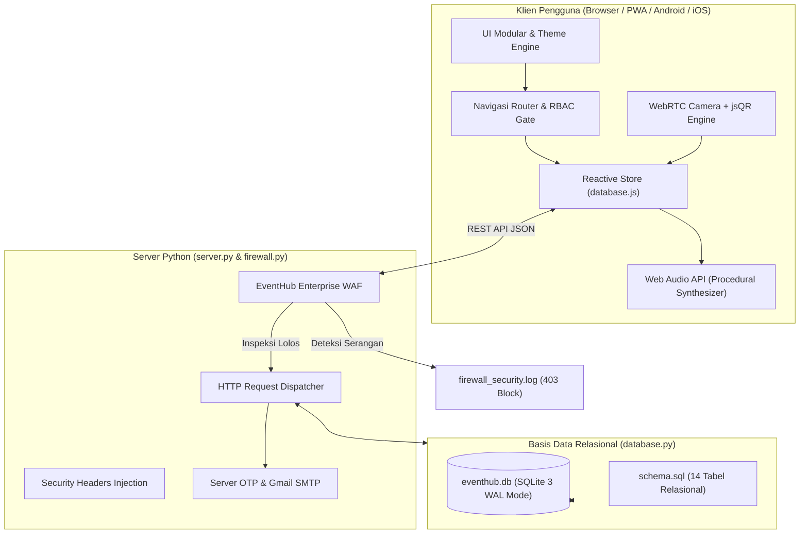
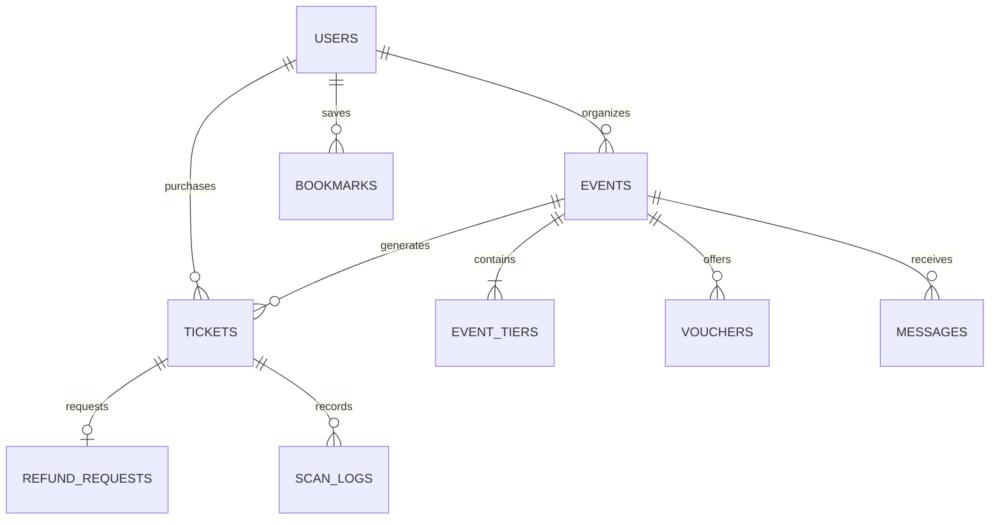

# Arsitektur Sistem & Spesifikasi Teknis: EventHub Pro

Dokumen ini menjelaskan arsitektur perangkat lunak, model relasional basis data, alur enkripsi, modul keamanan Web Application Firewall (WAF), dan subsistem prosedural dari **EventHub Pro**.

---

## 1. Filosofi & Paradigma Desain
EventHub Pro dibangun dengan pendekatan **Modular Monolith** berorientasi performa tinggi:
- **Zero-Dependency Frontend:** Seluruh interaksi antarmuka, generator QR SVG, efek audio procedural, confetti engine, dan scanner kamera berjalan tanpa framework bundler yang berat, menghasilkan waktu muat (LCP) < 400ms.
- **Relational Integrity with SQLite WAL Mode:** Database SQLite 3 beroperasi dengan *Write-Ahead Logging* (WAL) dan *Foreign Keys Enforcement* untuk menjamin konsistensi ACID transaksi tiket dan refund.
- **Zero-Knowledge Privacy Administrator:** Akun root administrator tidak pernah diekspos ke tabel publik dan audit log disamarkan untuk mencegah kebocoran data identitas pengelola sistem.
- **Defence-in-Depth Security:** WAF terpasang di level aplikasi sebelum request menyentuh controller, menyaring serangan SQLi, XSS, Path Traversal, dan brute-force.

---

## 2. Diagram Arsitektur Keseluruhan



---

## 3. Struktur Modul Frontend

Frontend terbagi menjadi modul-modul independen yang terisolasi dalam *Immediately Invoked Function Expressions* (IIFE) pada namespace global `window`:

| Modul | Berkas Utama | Tanggung Jawab |
|---|---|---|
| **Sistem Utama** | `sistem-utama/koordinator-aplikasi.js` | Inisialisasi aplikasi, lifecycle modal, routing global |
| **Penyimpanan Reaktif** | `sistem-utama/database.js` | State management, sinkronisasi backend, local storage persistence |
| **Router & RBAC** | `sistem-utama/navigasi-router.js` | Proteksi rute, rendering header, bottom action bar, toast stack |
| **Otentikasi Akun** | `otentikasi-akun/auth.js` | Form masuk/daftar, OTP verification, demo account quick login |
| **Sistem Peserta** | `sistem-peserta/peserta.js` | Katalog event, detail tier, pencarian, e-tiket, refund |
| **Fast-Track VIP** | `sistem-peserta/fast-track.js` | Paket langganan VIP, diskon dinamis, badge header |
| **POS Kasir Gate** | `panel-penyelenggara/kasir-organizer.js` | Validasi tiket gate, input manual, audio alert |
| **Scanner Kamera** | `scanner-kamera/camera-scanner.js` | WebRTC media stream, canvas rendering loop, jsQR decoder |
| **Panel Admin** | `panel-admin/dashboard-admin.js` | Monitoring WAF, CMS Hero, approval akun promotor, audit logs |
| **Audio Prosedural** | `sistem-utama/efek-suara.js` | Sintesis nada sinusoidal (Web Audio API) tanpa file audio MP3/WAV |
| **Efek Confetti** | `sistem-utama/efek-selebrasi.js` | Fisika partikel canvas 2D untuk selebrasi pembayaran sukses |

---

## 4. WebRTC Camera Scanner & Procedural Audio Engine

### Pemindaian Kode QR (30 FPS Stream):
Scanner memanfaatkan `navigator.mediaDevices.getUserMedia({ video: { facingMode: "environment" } })` untuk menangkap kamera belakang perangkat. Setiap frame digambar ke elemen `<canvas>` tersembunyi dan diurai oleh algoritma matriks `jsQR`:
1. Deteksi pola *Finder Pattern* 3 sudut QR.
2. Koreksi perspektif dan de-obfuscation bit matriks.
3. Ekstraksi kode tiket unik (contoh: `TKT-DEMO-VALID-01`).
4. Pencocokan ke database tiket dan pemeriksaan flag `is_checked_in`.

### Web Audio API Prosedural:
Tidak ada file audio `.mp3` atau `.wav` statis yang diunduh dari jaringan. Semua efek suara disintesis langsung menggunakan `AudioContext`:
- **Chime Sukses Check-in:** Dihasilkan dari dua osilator frekuensi gelombang sinusoidal (587 Hz [D5] bertransisi ke 880 Hz [A5]) dengan *gain decay exponential* 0.4 detik.
- **Buzz Error / Penolakan:** Dihasilkan dari osilator gelombang gergaji (Sawtooth) 130 Hz dengan modulasi frekuensi rendah untuk efek peringatan tegas.
- **Klik Antarmuka:** Gelombang sinus pendek 1200 Hz berdurasi 0.04 detik.

---

## 5. Model Relasional Basis Data (SQLite Schema)

Skema database tersimpan di `schema.sql` dan dieksekusi secara otomatis oleh `database.py`.



### Relasi & Kendala Integritas (Foreign Keys):
- `events.organizer_id` merujuk ke `users.id` (ON DELETE SET NULL).
- `event_tiers.event_id` merujuk ke `events.id` (ON DELETE CASCADE).
- `tickets.event_id` merujuk ke `events.id` (ON DELETE CASCADE).
- `refund_requests.ticket_code` merujuk ke `tickets.code` (ON DELETE CASCADE).
- `bookmarks` memiliki constraint `UNIQUE(user_email, event_id)` untuk mencegah bookmark ganda.

---

## 6. Enterprise Web Application Firewall (WAF)

Modul `firewall.py` memotong setiap request HTTP sebelum mencapai controller aplikasi:

### Vektor Deteksi & Ekspresi Reguler:
1. **SQL Injection (SQLi):**
   - Mendeteksi perintah berbahaya: `UNION SELECT`, `OR 1=1`, `DROP TABLE`, `INSERT INTO`, komentar SQL (`--`, `/* */`), serta hex encoding.
2. **Cross-Site Scripting (XSS):**
   - Mendeteksi tag `<script>`, atribut injeksi event handler (`onload=`, `onerror=`), `javascript:`, dan `eval()`.
3. **Path Traversal & LFI:**
   - Mendeteksi pola `../`, `..\\`, `/etc/passwd`, `win.ini`.
4. **Automated Scanner / Malicious User-Agent:**
   - Memblokir bot scanner otomatis seperti `sqlmap`, `nikto`, `nmap`, `havij`, `w3af`.
5. **Rate Limiting & Brute-force Guard:**
   - Melacak frekuensi request per alamat IP. Melebihi 60 request/menit memicu cooldown blokir otomatis status `429 Too Many Requests`.

### HTTP Security Headers yang Diinjeksikan:
```http
X-Frame-Options: DENY
X-Content-Type-Options: nosniff
X-XSS-Protection: 1; mode=block
Referrer-Policy: strict-origin-when-cross-origin
Permissions-Policy: camera=(self), microphone=()
```

---

## 7. Zero-Knowledge Privacy Administrator

Sistem menerapkan prinsip pemisahan data administratif:
1. **Penyaringan Kueri Pengguna:** Fungsi `Store.getUsers()` pada client secara ketat mengecualikan akun berstatus `superadmin` saat dipanggil oleh sesi non-admin.
2. **Masking Jejak Audit:** Log sistem yang dipicu oleh super admin dicatat dengan identitas anonim terenkripsi:
   - Nama Pengguna: `Administrator Sistem (Privat)`
   - Email: `admin@private.internal`
3. Hal ini memastikan bahwa jika akun penyelenggara diretas atau log audit diekspor ke pihak ketiga, identitas email asli dan kredensial root administrator tetap aman dan tidak dapat dilacak.

---

## 8. Siklus Hidup Sinkronisasi & Hidrasi Data

1. **Bootstrapping Awal:** Browser memuat `index.html`. Preloader menampilkan progres track animasi.
2. **Local Hydration:** `database.js` memeriksa `localStorage` versi `eventhub_pro_demo_v6`. Jika kosong, langsung menginisialisasi dari `INITIAL_DATA`.
3. **Backend Sync Handshake:** Modul menjalankan `hydrateFromBackend()` memanggil `/api/db/export`.
4. **Conflict Resolution:** Jika data SQLite server memiliki record event yang lebih lengkap, data client diperbarui secara mulus dan memicu re-render antarmuka tanpa reload halaman.
5. **Debounced Mutasi Client-to-Server:** Setiap transaksi pembelian tiket, check-in scanner, atau pembuatan acara mendebounce request `POST /api/db/sync` selama 300ms untuk menjamin efisiensi bandwidth jaringan.
